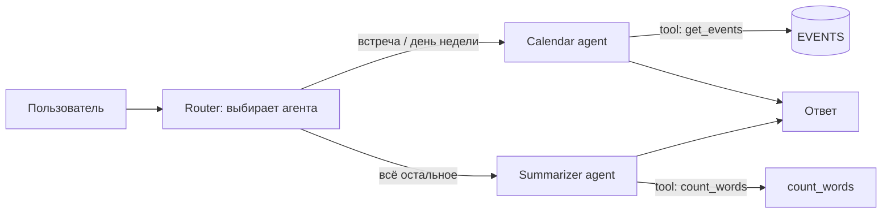

# Мини-пример: агенты и пайплайн

Запуск (ничего устанавливать не нужно):

```bash
python3 agents_demo/agents.py
```

## Схема пайплайна



GitHub показывает такие схемы прямо в файле `.md`, так что картинку рисовать не нужно.

## Из чего состоит агент

| Часть | Что это | В примере |
|---|---|---|
| **Роль** (instructions) | Текст: кто агент и что он делает | `instructions="Отвечай про встречи..."` |
| **Инструменты** (tools) | Функции, которые агент может вызвать | `get_events`, `count_words` |
| **Мозг** (brain) | Решает: вызвать инструмент или дать ответ | функции `calendar_brain`, `summarizer_brain` |
| **Цикл** | Думать -> инструмент -> результат -> снова думать | метод `Agent.run` |
| **Пайплайн** | Агенты передают задачи друг другу | функция `pipeline` |

В этом примере «мозг» написан правилами. В настоящем агенте его заменяет языковая модель: она получает роль, список инструментов и задачу, и отвечает либо вызовом инструмента, либо текстом.

## Как заменить правила на настоящую модель

1. Установить SDK: `pip install anthropic`
2. Задать ключ: `export ANTHROPIC_API_KEY=...`
3. В `brain` вызывать `client.messages.create(system=..., tools=..., messages=...)` и разбирать ответ: `tool_use` значит «вызови инструмент», текст значит «ответ».

Структура кода при этом не меняется: меняется только содержимое `brain`.

## Где смотреть пайплайн «картинкой»

- **Схема в коде** (как выше, Mermaid): показывает, как связаны агенты. Это схема, а не живой запуск.
- **Визуальные конструкторы** (n8n, Flowise, Dify): агенты собираются из блоков на холсте, и поток видно сразу.
- **Граф в LangGraph** (LangGraph Studio): агенты и переходы между ними как граф, который можно открыть и посмотреть.
- **Трассировка запусков** (LangSmith, Langfuse, Arize Phoenix): для каждого запуска видно дерево шагов: какой агент работал, какой инструмент вызвал, что получил и сколько это заняло. Это лучший способ понять, что агент делает на самом деле.
- **Лог в этом примере**: каждый запуск печатает шаги в консоль, например `[Calendar] вызывает инструмент get_events(...)`. Это та же идея, что трассировка, только текстом.
